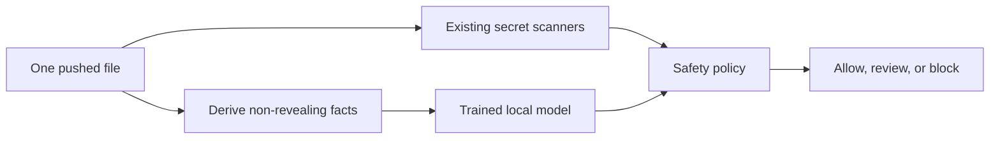

# Trained Review Experiment

This experiment asks a narrow practical question: can a locally trained model
help the existing scanners catch more secrets and remove more false alarms
without exposing the text being checked?

The model never replaces the scanners. It receives only a short set of derived
facts, such as file type, assignment style, length range, character mix, and
whether the text matches a recognized format. It does not receive the suspected
value, source line, file path, repository name, hash, or line number.



## Safety behavior

The integration keeps several decisions outside the trained model:

- Private-key findings always block.
- Scanner execution errors always block and cannot be cleared by the model.
- Explicit placeholders and recognized safe formats may be cleared by fixed
  rules.
- The model uses one confidence threshold when trying to recover a scanner
  miss and another when trying to remove a false alarm.
- If the model is missing, fails, returns an invalid answer, or is not confident
  enough, the scanner decision stands.
- Thresholds are selected only with the setup data. The final test remains
  untouched until all choices are fixed.

## Data design

The training data contains 30,000 files from 1,500 simulated repositories. A
separate setup group contains 1,200 files from 60 repositories. After the
training design was fixed, a new final test was generated with a different
seed. It contains 4,800 newly generated files from another 240 repositories.
Family, layout, note, and value choices were independently randomized. The
saved v7 result is retained as a historical comparison, not reused as the new
final score.

No repository appears in more than one group. The generated files cover 16
secret families, 16 safe lookalike families, 10 common code and configuration
layouts, and direct and split assignments. The training coverage audit checks
all 320 family-and-layout combinations and reports the smallest represented
groups. This is broad, practical coverage; it is not a claim that every future
secret format or repository style is represented.

The final test measures performance on previously unseen files, values, and
repositories rather than memory of training examples. It samples the same 32
defined secret and safe-lookalike families, so it measures generalization to
new examples within this practical scope. It does not prove performance for a
brand-new secret family. Because the test remains simulated, future work
should also use carefully reviewed real-world findings whose sensitive text has
been removed before collection.

## Models compared

All three approaches receive the same derived facts:

1. LightGBM provides a fast, lightweight reference point.
2. IBM Granite 4.1 3B Base is adapted locally with LoRA.
3. Qwen3 4B Base is adapted locally with LoRA.

The training run records the exact upstream revision, software versions,
training settings, input hashes, learning history, artifact hashes, and random
seed. The two larger models train on separate GPUs. The comparison reports
precision, recall, F1, misses recovered, false alarms removed, newly introduced
mistakes, and review latency.

## Reproduce the experiment

Create the private data outside the Git checkout:

```bash
export SHIFT_LEFTER_ROOT="$HOME/.local/share/shift-lefter"
.venv/bin/python tools/trained_review_data.py build
.venv/bin/python tools/trained_review_data.py scan-setup --workers 16
.venv/bin/python tools/trained_review_data.py prepare-final
.venv/bin/python tools/trained_review_data.py verify
.venv/bin/python tools/audit_trained_review.py coverage
.venv/bin/python tools/fresh_trained_review_test.py build
```

Train each approach:

```bash
.venv/bin/python tools/train_trained_review.py lightgbm
CUDA_VISIBLE_DEVICES=0 .venv/bin/python tools/train_trained_review.py adapter --model granite --epochs 1
CUDA_VISIBLE_DEVICES=1 .venv/bin/python tools/train_trained_review.py adapter --model qwen --epochs 1
```

For each model, predict the setup data and select the two thresholds. Do not
activate or score the new final test during this step:

```bash
.venv/bin/python tools/train_trained_review.py predict --model MODEL --split setup
.venv/bin/python tools/evaluate_trained_review.py calibrate --model MODEL
```

After every threshold is fixed, scan and verify the new final test. Sixteen
workers match the earlier successful setup scan. Do not increase this value:
each file starts three scanner processes, and excessive concurrency can exhaust
system resources.

```bash
.venv/bin/python tools/fresh_trained_review_test.py scan --workers 16
.venv/bin/python tools/fresh_trained_review_test.py verify
.venv/bin/python tools/activate_trained_review_test.py
```

Only then score the final test:

```bash
.venv/bin/python tools/train_trained_review.py predict --model MODEL --split final
.venv/bin/python tools/evaluate_trained_review.py evaluate --model MODEL
```

Then create the comparison and quality review:

```bash
.venv/bin/python tools/evaluate_trained_review.py compare
.venv/bin/python tools/audit_trained_review.py training-quality
```

## Results

The final test contained 4,800 files from 240 new simulated repositories:
1,600 files with secrets and 3,200 safe files. None of those repositories,
files, or credential-shaped values appeared in training or setup data. The
privacy check found no forbidden fields in model inputs and no raw test values
outside the protected data directory.

The scanner-only starting point found 1,497 secrets, missed 103, and raised
1,970 false alarms. Its precision was 43.18%, recall was 93.56%, and F1 was
59.09%. Fixed safety rules removed 1,429 false alarms without creating a new
miss, raising precision to 73.45% and F1 to 82.30%. They did not recover any of
the 103 scanner misses.

| Approach | Precision | Recall | F1 | Misses | False alarms | Misses recovered | False alarms removed |
| --- | ---: | ---: | ---: | ---: | ---: | ---: | ---: |
| Scanner only | 43.18% | 93.56% | 59.09% | 103 | 1,970 | — | — |
| Scanner plus fixed rules | 73.45% | 93.56% | 82.30% | 103 | 541 | 0 | 1,429 |
| LightGBM hybrid | 74.68% | 99.75% | 85.42% | 4 | 541 | 99 | 1,429 |
| Granite hybrid | 66.84% | 99.25% | 79.88% | 12 | 788 | 91 | 1,182 |
| Qwen hybrid | 74.68% | 99.75% | 85.42% | 4 | 541 | 99 | 1,429 |

LightGBM and Qwen produced the same final hybrid decisions. Each recovered 99
of the 103 scanner misses, removed 1,429 of the 1,970 scanner false alarms,
and introduced no new miss or false alarm compared with the scanner. All 90
private-key files remained blocked. Granite recovered 91 misses, but it left
247 more false alarms than the fixed-rule layer and finished below the
fixed-rule-only F1 score.

The result supports using a trained local reviewer, but not using a large
language model by default for these inputs. LightGBM ranked first on setup data
and matched Qwen on the untouched final test while using far less compute.
Qwen shows that a locally trained language model can learn the task, but it did
not improve the deployed outcome over LightGBM. Granite did not provide a
favorable precision tradeoff at its setup-selected thresholds.

For one-file calls with an already loaded model, mean review time was 0.72 ms
for LightGBM, 84.26 ms for Granite, and 77.54 ms for Qwen. Loading took 1.02
seconds for LightGBM and about 13 seconds for each adapter. These measurements
favor a persistent process if an adapter is used, but a normal single-push
workflow does not require batching a large dataset.

The final test uses new repositories, files, and values, but it draws from the
same 32 defined secret and safe-lookalike families as training. Every final
file's combination of approved low-detail facts had appeared somewhere in the
training data. The experiment therefore measures performance on new examples
within the defined families; it does not establish performance on an unknown
secret family or an arbitrary real repository. Carefully reviewed real-world
findings are the next useful validation step.

The setup-selected default is LightGBM. The complete sanitized decisions,
per-family results, training history, hashes, and timing evidence are stored in
`results/sanitized-results/evaluation-v8-trained-review/`.
