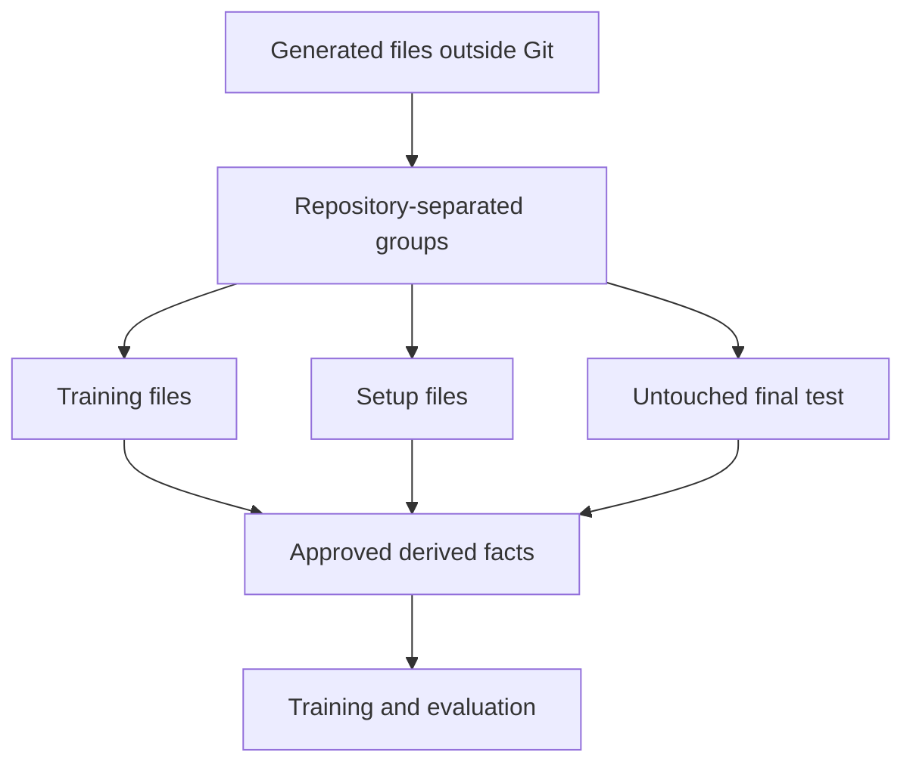

# Trained Review Data

This directory publishes the evidence needed to understand and reproduce the
data preparation without publishing credential-shaped text.

- `summary.json` reports counts, labels, repository separation, and coverage.
- `lock.json` records the fixed seed and hashes of the generator and derived
  model inputs.
- `privacy-verification.json` records the check that raw test values remain
  outside Git and that model inputs contain only approved fields.
- `training-coverage.json` reports representation across secret families, safe
  lookalikes, file layouts, and repository groups.
- `setup-scan-summary.json` records the scanner versions and setup scan hash.
- `fresh-final-build-summary.json` records the new final test's seed, counts,
  source hashes, and repository separation.
- `fresh-final-scan-summary.json` records scanner versions, worker count,
  duration, and the completed final scan hash.
- `fresh-final-privacy-verification.json` records the privacy checks applied to
  the new final test.
- `final-summary.json` records activation of the new final test and preserves
  the earlier v7 data hash for historical comparison.

The raw generated files stay under the private Shift Lefter data directory on
the test system. They are deliberately excluded from Git. Training, setup, and
final-test repositories do not overlap.

This design tests previously unseen files and repositories. It provides broad,
realistic simulated coverage, but it cannot guarantee identical performance on
every future secret format or development environment.
