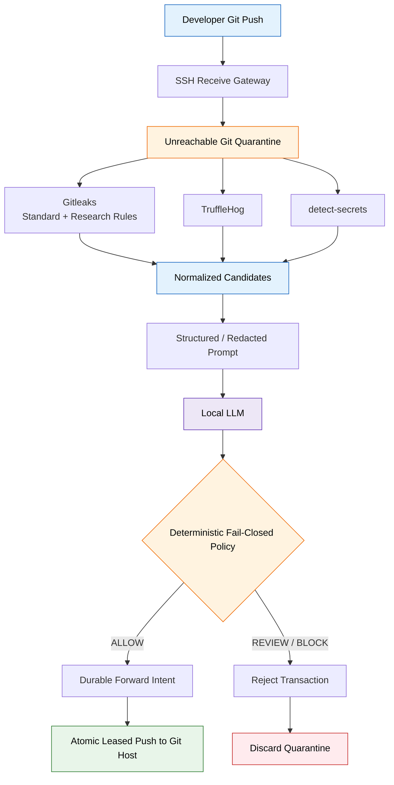

# Transparent Git Receive Gateway

## Purpose and honest boundary

Run the decision engine in a front-door bare Git gateway rather than in every developer clone. Developers use their ordinary `git commit` and `git push` commands. Their local commit already exists; a server-side control cannot intervene in `git add` or `git commit`. The gateway prevents a rejected transaction from making an authoritative upstream ref reachable or triggering the Git host's CI, pull-request, or merge-request consumers.

Git receives proposed objects into a quarantine directory before invoking `pre-receive`. The gateway scans every object newly reachable from all proposed tips, including intermediate-history blobs and human-authored commit or annotated-tag messages. A secret added in one commit and removed in a later commit is still evaluated.
 


The model participates in candidate classification. It receives scanner/rule metadata, file type, candidate-line redactions, allowlisted semantic markers, and structural features. It never receives a raw source line or candidate value. The model cannot override private-key hard blocks. Scanner failures, model failures, malformed responses, ambiguity, and low confidence all reject the receive transaction.

The reference gateway defaults to strict policy. A scanner finding remains a hold even when the model recommends `allow`; the recommendation supplies review context but cannot clear the push. The separately measured `contextual` mode permits a high-confidence model allow and must be enabled explicitly with `SHIFT_LEFTER_POLICY_MODE=contextual`. Do not use that mode for enforcement until evaluation on representative repositories meets an approved false-negative threshold.

## Atomic forwarding and audit order

The gateway validates the exact upstream hostname, rejects credentials embedded in HTTPS URLs, writes and fsyncs a sanitized pre-forward intent, and invokes one upstream `git push --atomic`. Every ref includes an explicit `--force-with-lease=<ref>:<expected-old>` expectation, preventing a concurrent upstream update from being overwritten.

If scanning, intent persistence, or forwarding fails, the gateway returns nonzero and its own receive transaction is rejected. If the upstream accepts the atomic push but the completion audit append then fails, the gateway returns success: reporting rejection would contradict authoritative upstream state and could cause an unsafe retry. The durable intent record marks the transaction for reconciliation.

Audit records contain an event hash, verdict, reason code, counts, and hashed ref names. They do not contain source bytes, filenames, raw scanner output, prompts, completions, or exception messages.

## Reference container

Build from the repository root:

```bash
docker build -f shift_lefter/container/Containerfile \
  -t shift-lefter-gateway:research .
```

The image checksum-verifies pinned Gitleaks and TruffleHog archives, pins detect-secrets, disables SSH passwords, forwarding, tunneling, and TTY allocation, and uses a forced command that permits only `git-receive-pack` or `git-upload-pack` for the configured repository. Raw-object materialization is directed to `/run/shift-lefter`, which must remain ephemeral.

The reference image is not rootless. `sshd` starts with the privileges required to authenticate and then runs Git sessions as the unprivileged `git` user. Production should add a read-only application filesystem, bounded tmpfs, seccomp/AppArmor or SELinux, CPU/memory/process/file-size/time limits, immutable image references, health monitoring, and no Docker socket.

Runtime configuration:

```text
SHIFT_LEFTER_PROJECT_NAME
SHIFT_LEFTER_UPSTREAM_URL
SHIFT_LEFTER_UPSTREAM_HOST
SHIFT_LEFTER_MODEL_ENDPOINT
SHIFT_LEFTER_MODEL_NAME
SHIFT_LEFTER_ALLOWED_MODEL_HOSTS
SHIFT_LEFTER_CA_BUNDLE
SHIFT_LEFTER_LOCAL_API_KEY_FILE or SHIFT_LEFTER_LOCAL_API_KEY_ENV
```

Mount authorized keys, a project-scoped upstream SSH credential, strict known-hosts configuration, the internal CA bundle, persistent gateway/audit volumes, and persistent SSH host private keys at `/run/secrets/ssh_host_ed25519_key` and `/run/secrets/ssh_host_rsa_key`. Generate those host keys once outside the container, protect them as deployment secrets, and preserve them across image upgrades. The container deliberately refuses to start without them. Rotating a host key is a managed security event because developer clients will reject an unannounced replacement. Network policy should deny general egress and permit only the configured Git host and local-model destinations.

## Hosted GitHub upstream

The front-door design is intended to forward to GitHub over SSH, but that path has not been demonstrated by this project. A GitHub validation must first confirm that the selected repository and protocol accept the gateway's required atomic multi-ref push behavior; lack of atomic support fails closed. The simplest current credential is a repository-scoped deploy key with write access; GitHub recommends a GitHub App when finer permissions and credential lifecycle are needed. App-based HTTP Git authentication requires a separate credential adapter because the reference container currently demonstrates SSH forwarding.

A GitHub deployment must also prevent direct pushes from bypassing the gateway. Configure branch and tag rulesets so only the gateway's narrowly scoped app or deploy-key actor can create, update, or delete protected refs, and validate those rules against feature branches, tags, forks, web edits, API writes, and administrators. Preserve the original developer identity in the gateway audit because the upstream push is performed by the gateway credential. GitHub documents write-enabled deploy keys at <https://docs.github.com/en/authentication/connecting-to-github-with-ssh/managing-deploy-keys> and ruleset restrictions at <https://docs.github.com/en/repositories/configuring-branches-and-merges-in-your-repository/managing-rulesets/available-rules-for-rulesets>.

GitLab was the upstream used for the laboratory evidence. GitHub compatibility is architectural and must be verified with a dedicated end-to-end test before a production claim.

## Self-managed GitLab custom-hook variant

A GitLab custom `pre-receive` hook can run the scanner directly when brief storage inside GitLab's own quarantine is acceptable. That design is operationally simpler and retains GitLab identity and protocol behavior, but rejected objects reach the GitLab host before policy evaluates them. Git removes the quarantine after rejection, so they do not become reachable refs.

The front-door gateway enforces the stronger storage boundary: rejected objects never reach the upstream host. It is also harder to operate. The reference implementation supports SSH for one mapped repository; it does not yet provide Git smart HTTP, dynamic host authorization, original pusher identity at the upstream, push-option forwarding, signed-push metadata, or high availability.

## Scope exclusions

Git LFS uploads use a separate HTTP object path; the receive gateway sees only pointer files. LFS must be prohibited or protected by a separate upload scanner. Submodule targets and external artifact/package registries are also outside this Git-object boundary.

The parser currently expects 40-character SHA-1 object IDs. SHA-256-format repositories require separate compatibility work. Repository-scale latency, very large blobs, long histories, concurrent pushes, and resource-exhaustion behavior require load tests before production.

The gateway is transparent to the developer's commands, not invisible to platform engineering. Managed clone URLs or DNS must direct pushes to it. Because upstream pushes use a service credential, the gateway audit must bind each authenticated developer key to the transaction so accountability is preserved.

## Rollout

1. Test in an isolated project using synthetic and revoked credentials.
2. Validate authentication, identity binding, protected refs, force pushes, tags, deletes, multi-ref atomicity, concurrency, outages, and size limits.
3. Begin with deterministic hard blocks and contextual decisions in observe-only reporting.
4. Enable enforcement only after representative recall, false-positive, stability, and latency thresholds pass.
5. Retain CI scanning, credential rotation, and incident response as independent controls.
6. Deploy through the normal infrastructure process. Building and testing this image does not authorize or perform deployment.
